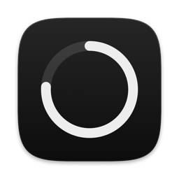
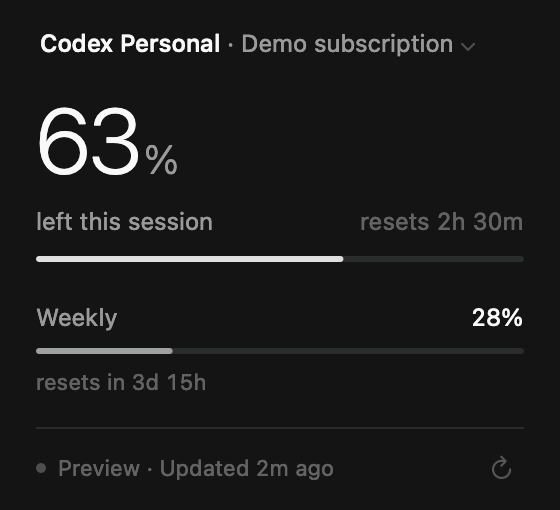
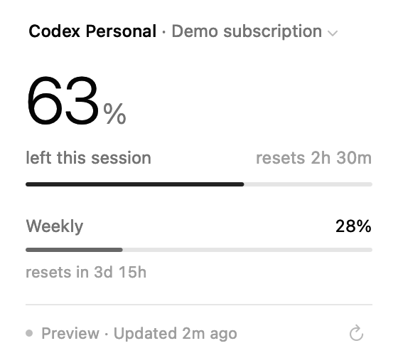
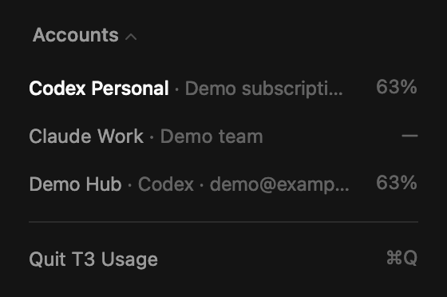

<p align="center"></p>

# T3 Usage

A small macOS menu bar app that shows how much of your AI subscription quota is left, as reported by [T3 Code](https://github.com/pingdotgg/t3code). The menu bar shows a ring and the remaining percent. Click it for a card with the reset countdown, the weekly window and an account switcher.

> **Unofficial.** This is a personal companion app, not made by or affiliated with the T3 team. It reads quota through T3 Code's local CLI and server, which are not a documented public API, so a T3 Code update can break it.

<p align="center">
  
  
  
</p>

Screenshots use demo data.

## Requirements

- Apple Silicon Mac, macOS 13 or later (tested on macOS 27)
- Swift 6.2 (Xcode or the Command Line Tools)
- T3 Code installed and running, with its CLI at `~/.t3/bin/t3`

## Build and install

```sh
git clone https://github.com/aliren/t3-usage-menubar.git
cd t3-usage-menubar
./scripts/check.sh      # core tests
./scripts/build.sh      # builds dist/T3 Usage.app (ad-hoc signed)
cp -R "dist/T3 Usage.app" ~/Applications/
open ~/Applications/"T3 Usage.app"
```

The app has no Dock icon and does not add itself to login items. To start it at login, add it in System Settings → General → Login Items.

Because the build is ad-hoc signed, macOS may ask you to confirm the first launch.

## Using it

- **Menu bar:** ring plus remaining percent. The value is dimmed when the data is stale or missing, and the ring turns orange at 20% or less.
- **Card:** click the account name to switch accounts. Esc goes back, ⌘Q quits. The refresh button rereads T3 right away.
- **States:** right after a session reset the card says "Reset" until T3 reports the new allowance. "Unavailable" means T3 couldn't read the quota, "Not tracked" means T3 doesn't report quota for that account. The app never guesses a number, so it won't show 100% until T3 does.

## How it works

On each read, the app asks the T3 CLI for a short-lived, read-only session (`orchestration:read`), opens T3's local config stream, takes the provider quota snapshot and revokes the session. The token stays in memory and is never written to disk, logged or passed as a process argument. The app doesn't change T3's settings, force provider checks or make model calls.

It reads every 5 minutes, once a minute while a reset is pending, and when you open the card if the last read is over 30 seconds old. Remaining percent is `floor(100 − usedPercent)` from T3's snapshot.

The only thing saved is your selected account and window, as hashes, in the `local.ali.T3Usage.preferences` defaults domain.

[Research/integration.md](Research/integration.md) has the details of the T3 integration.

## Diagnostics and previews

```sh
APP="dist/T3 Usage.app/Contents/MacOS/T3Usage"
"$APP" --diagnose                       # one live read, prints JSON without labels, emails or tokens
"$APP" --fixture current                # run with demo data, no T3 needed
"$APP" --fixture reset --dark --render-fixture out.png   # render the card to a PNG
```

Fixture scenarios: `current`, `stale`, `failed`, `unsupported`, `missing`, `reset`. Add `--accounts` to render the account list.

`python3 scripts/verify-package.py --live` checks the built app end to end.

To regenerate the icon:

```sh
swift scripts/make-icon.swift /tmp/AppIcon.iconset && iconutil -c icns /tmp/AppIcon.iconset -o Resources/AppIcon.icns
```

## Uninstall

Quit the app, delete `~/Applications/T3 Usage.app`, and optionally run:

```sh
defaults delete local.ali.T3Usage.preferences
```

## License

[MIT](LICENSE)
